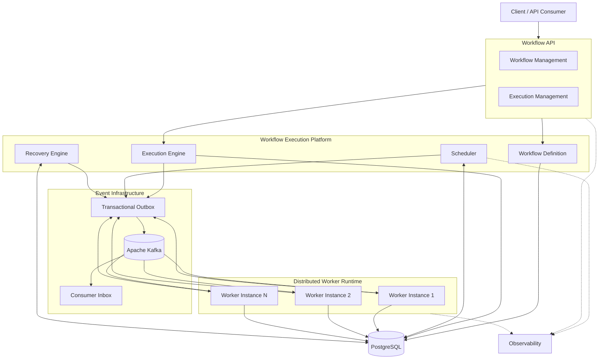

# Distributed Workflow Engine V2

<p align="center">

**A fault-tolerant, event-driven distributed workflow orchestration engine.**

Build, schedule, execute, and monitor complex workflows across distributed workers with reliability, scalability, and observability.

</p>

<p align="center">


</p>

---

## Overview

Distributed Workflow Engine V2 is a redesigned, event-driven workflow orchestration platform designed to execute dependency-based workflows across distributed worker nodes.

The engine models workflows as Directed Acyclic Graphs (DAGs), schedules tasks according to their dependencies, and distributes execution across multiple workers using asynchronous event-driven communication.

The primary focus of V2 is building a reliable execution engine that can handle concurrency, failures, retries, worker crashes, and recovery without losing execution state.

Unlike a simple job scheduler, the engine is designed around durable workflow execution, independent task attempts, atomic task ownership, and recoverable distributed processing.

**V2 is currently under active development.** The architecture and engineering foundation are being established before implementation of the execution engine.

## Vision

The goal is to build a workflow orchestration platform that provides:

- DAG-based workflow definitions.
- Versioned and reusable workflow definitions.
- Independent workflow execution instances.
- Dependency-aware task scheduling.
- Distributed task execution across multiple workers.
- Configurable retry policies and exponential backoff.
- Worker heartbeat and lease-based recovery.
- Idempotent event processing.
- Durable execution history and task results.
- Workflow lifecycle management.
- Distributed tracing and operational observability.

## Architecture

The system follows an event-driven architecture with PostgreSQL as the durable source of truth and Apache Kafka as the asynchronous messaging infrastructure.

### High-level architecture



### Execution flow

A typical workflow execution follows this sequence:

1. A client submits a workflow execution request.
2. The Workflow API validates the requested workflow version.
3. The Execution Engine creates a durable workflow execution.
4. Task execution records are created for the workflow.
5. The Scheduler evaluates task dependencies.
6. Eligible tasks transition to `READY`.
7. Task-ready events are published to Kafka through the transactional outbox.
8. Available workers consume task-ready events.
9. A worker atomically claims an eligible task.
10. The worker executes the registered task handler.
11. Task results and execution state are persisted.
12. Completion events notify the execution platform.
13. The Scheduler evaluates downstream dependencies.
14. The process continues until the workflow reaches a terminal state.

## Core Architectural Principles

### 1. Durable Execution

PostgreSQL is the source of truth for workflow definitions, execution state, task attempts, and execution history.

The engine must be able to recover its execution state after application restarts.

### 2. Event-Driven Communication

Apache Kafka provides asynchronous communication between scheduling, execution, and worker components.

Components communicate through versioned event contracts rather than relying on synchronous service-to-service calls for task dispatch.

### 3. At-Least-Once Delivery

The engine uses at-least-once message delivery with idempotent consumers.

It does not claim exactly-once execution of arbitrary external side effects.

### 4. Transactional Outbox

Database state changes and corresponding outgoing events are persisted in the same transaction.

An independent publisher delivers committed outbox events to Kafka.

### 5. Atomic Task Ownership

A Kafka event does not grant a worker exclusive ownership of a task.

Workers must successfully claim tasks through an atomic database operation before execution.

### 6. Failure Recovery

Worker leases, heartbeats, fencing tokens, and retry policies help the engine recover abandoned tasks while preventing stale workers from overwriting newer results.

### 7. Independent Workflow Executions

A workflow definition can be executed multiple times independently.

Each execution maintains its own task execution records, attempts, results, and lifecycle.

## Planned Capabilities

| Capability | Description |
|---|---|
| Workflow Definitions | Create and manage reusable workflows |
| DAG Validation | Validate dependencies and detect cycles |
| Workflow Versioning | Maintain immutable published versions |
| Dependency Scheduling | Schedule tasks after prerequisites succeed |
| Distributed Workers | Execute tasks across multiple worker instances |
| Task Attempts | Maintain individual execution attempt history |
| Retry Policies | Support configurable retries and backoff |
| Worker Recovery | Recover tasks after worker failures |
| Idempotency | Handle duplicate event delivery safely |
| Execution History | Maintain durable workflow and task history |
| Cancellation | Support workflow cancellation |
| Observability | Expose metrics, logs, and distributed traces |

These capabilities represent the V2 design and implementation roadmap; they are not all implemented yet.

## Technology Stack

| Category | Technology |
|---|---|
| Programming Language | Java 21 |
| Application Framework | Spring Boot 4.1.2 |
| Build System | Apache Maven |
| Database | PostgreSQL |
| Messaging | Apache Kafka |
| Database Access | Spring Data JPA |
| Database Migrations | Flyway |
| Testing | JUnit 5, Mockito |
| Integration Testing | Testcontainers |
| Containerization | Docker, Docker Compose |
| Metrics | Micrometer, Prometheus |
| Dashboards | Grafana |
| Distributed Tracing | OpenTelemetry |
| API Documentation | OpenAPI |

Redis may be introduced for caching or ephemeral coordination where justified. PostgreSQL remains the durable source of truth.

## Project Structure

V2 is developed independently inside the `v2/` directory to avoid disrupting the original implementation.

```text
DistributedWorkflowEngine/
│
├── common-libs/                  # Legacy implementation
├── workflow-service/             # Legacy implementation
├── scheduler-service/             # Legacy implementation
├── worker-service/                # Legacy implementation
│
├── docs/
│   └── v2/
│       ├── architecture.md
│       ├── database-design.md
│       ├── event-driven-design.md
│       ├── execution-lifecycle.md
│       └── implementation-roadmap.md
│
└── v2/
    ├── pom.xml
    ├── README.md
    │
    └── [Planned Maven modules]
        ├── workflow-api/
        ├── workflow-definition/
        ├── execution-engine/
        ├── scheduler/
        ├── worker-runtime/
        ├── task-sdk/
        ├── event-contracts/
        ├── event-publisher/
        ├── recovery-engine/
        ├── execution-history/
        └── observability/
```

The module structure represents the planned architecture. Modules will be introduced incrementally as their implementation phases begin.

## Getting Started

### Prerequisites

Install the following:

- JDK 21
- Apache Maven 3.9.12 or compatible
- Git

Infrastructure dependencies such as PostgreSQL and Kafka will be introduced as their corresponding implementation phases are completed.

### Verify Java

```bash
java -version
```

Expected Java major version:

```text
21
```

### Verify Maven

```bash
mvn -version
```

### Build V2

From the repository root:

```bash
mvn -f v2/pom.xml clean verify
```

This builds the independent V2 Maven project without changing the legacy root Maven project.

## Database Design

PostgreSQL will manage the durable state of the workflow engine.

The planned data model includes:

| Table | Responsibility |
|---|---|
| workflow_definitions | Workflow identity and metadata |
| workflow_definition_versions | Immutable workflow versions |
| task_definitions | Reusable task definitions |
| task_dependencies | DAG dependency relationships |
| workflow_executions | Individual workflow runs |
| task_executions | Runtime task state |
| task_attempts | Individual execution attempts |
| outbox_events | Reliable outgoing event publication |
| consumer_inbox | Idempotent event processing |
| execution_events | Execution history and audit trail |

Database schema changes will be managed using Flyway migrations.

For detailed database design, see [database-design.md](../docs/v2/database-design.md).

## Execution Lifecycle

### Workflow Execution States

```text
CREATED
   |
   v
RUNNING
   |
   +------> SUCCEEDED
   |
   +------> FAILED
   |
   +------> CANCELLING
                |
                v
             CANCELLED
```

### Task Execution States

```text
PENDING
   |
   v
READY
   |
   v
RUNNING
   |
   +------> SUCCEEDED
   |
   +------> FAILED
   |
   +------> RETRY_WAIT
   |            |
   |            v
   |           READY
   |
   +------> CANCELLED
```

Task execution state transitions will be explicitly validated and persisted.

See [execution-lifecycle.md](../docs/v2/execution-lifecycle.md) for detailed lifecycle rules.

## Reliability and Fault Tolerance

Reliability is a core design requirement.

The engine is being designed with:

- Transactional outbox and consumer inbox patterns.
- Idempotent event consumers.
- Atomic task claiming.
- Worker lease management.
- Heartbeat-based worker health.
- Fencing tokens for stale-worker protection.
- Configurable retry policies.
- Exponential backoff and jitter.
- Timeout detection.
- Dead-letter queue handling.
- Durable execution history.

The objective is to recover safely from failures without silently losing or corrupting execution state.

## Testing Strategy

The project will use multiple levels of automated testing.

### Unit Tests

Validate:

- DAG validation.
- Dependency evaluation.
- State transitions.
- Retry policy calculations.
- Event serialization.
- Task handler behavior.

### Integration Tests

Validate:

- Database persistence.
- Transactional outbox behavior.
- Consumer inbox deduplication.
- Atomic task claiming.
- Concurrent scheduler behavior.
- Worker execution and recovery.

### Distributed Failure Tests

Validate:

- Duplicate event delivery.
- Worker termination during execution.
- Expired lease recovery.
- Stale worker completion rejection.
- Kafka unavailability.
- Retry exhaustion.

Testcontainers will be used to run realistic integration tests against PostgreSQL and Kafka.

## Development Roadmap

The project will be developed incrementally through the following phases:

| Phase | Scope |
|---|---|
| 0 | Legacy preservation |
| 1 | Architecture and engineering foundation |
| 2 | Maven project foundation |
| 3 | Workflow definitions and DAG engine |
| 4 | Durable execution engine |
| 5 | Event infrastructure |
| 6 | Distributed scheduler |
| 7 | Worker runtime |
| 8 | Retry and recovery |
| 9 | Workflow lifecycle and advanced capabilities |
| 10 | Observability and production readiness |

Track implementation progress in [implementation-roadmap.md](../docs/v2/implementation-roadmap.md).

## Contributing

Contributions and discussions are welcome.

V2 development follows a feature-branch and pull-request workflow.

### Branch Strategy

| Branch | Purpose |
|---|---|
| `main` | Original implementation and stable integration |
| `v2-development` | V2 integration branch |
| `feature/*` | New features |
| `fix/*` | Bug fixes |
| `docs/*` | Documentation improvements |

### Contribution Workflow

1. Fork or clone the repository.
2. Switch to `v2-development`.
3. Create a focused feature branch.
4. Implement the change with appropriate tests.
5. Run the relevant Maven build and checks.
6. Push the branch.
7. Open a pull request targeting `v2-development`.

Example:

```bash
git switch v2-development

git pull --ff-only origin v2-development

git switch -c feature/your-feature-name

# Implement your changes

git add .

git commit -m "feat: describe your change"

git push -u origin feature/your-feature-name
```

All significant changes should be reviewed through pull requests.

### Engineering Expectations

- Follow Java 21 language conventions.
- Keep module responsibilities clearly separated.
- Include tests for new functionality.
- Use Flyway for database schema changes.
- Avoid direct database/Kafka dual writes.
- Preserve event compatibility.
- Do not introduce exactly-once execution claims.
- Document significant architectural decisions.

## Architecture Documentation

The detailed V2 specifications are maintained separately:

- [System Architecture](../docs/v2/architecture.md)
- [Database Design](../docs/v2/database-design.md)
- [Event-Driven Design](../docs/v2/event-driven-design.md)
- [Execution Lifecycle](../docs/v2/execution-lifecycle.md)
- [Implementation Roadmap](../docs/v2/implementation-roadmap.md)

## License

This project is licensed under the MIT License.

See the repository's [LICENSE](../LICENSE) file for details.

---

<p align="center">

**Distributed Workflow Engine V2**

*Reliable execution. Distributed processing. Fault-tolerant orchestration.*

</p>